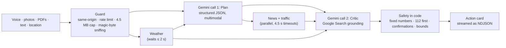

# LifeSync

**From a messy moment to the next right step.** LifeSync turns any messy real-world input (a voice note, a photo of a prescription, a PDF report, a forwarded rumour, live weather, news and traffic) into one structured, fact-checked **action card** in the user's own Indian language, and says plainly what it could not verify.

> LifeSync is an AI assistant, not a doctor or emergency service. In an emergency, call **112**.

## The problem, and how LifeSync answers it

> _Build a Gemini-powered app that acts as a universal bridge between human intent and complex systems: take unstructured, messy, real-world inputs (voice, traffic, weather, news, photos, a messy stack of medical history) and instantly convert them into structured, verified, life-saving actions._

| The brief asks for          | What LifeSync does                                                                                                                                                                                                                                   | Where                                                  |
| --------------------------- | ---------------------------------------------------------------------------------------------------------------------------------------------------------------------------------------------------------------------------------------------------- | ------------------------------------------------------ |
| **Messy, multimodal input** | One form takes typed text in any language, a 30-second voice note, up to six photos or PDFs or text files, and the user's location. Gemini reads them all natively in a single call. No separate speech-to-text or OCR step.                         | `components/InputPanel.tsx`, `lib/server/input.ts`     |
| **Live context**            | Weather (Open-Meteo), recent Indian news (Google News RSS) and, with a Maps key, drive time with traffic to the nearest hospital or shelter. A failed signal is recorded, never fatal.                                                               | `lib/server/signals/`                                  |
| **Structured output**       | Every answer is validated against one zod schema: risk level, ordered actions, contacts, facts with status, health card, rumour verdict, confidence, and what could not be verified. Invalid replies are repaired once, then rejected.               | `lib/schema.ts`, `lib/server/analyze.ts`               |
| **Verified**                | A second Gemini pass with **Google Search grounding** checks every claim, removes unsupported ones, lowers confidence and cites sources. If it fails, the card is labelled _not verified_ and confidence is capped at 40%.                           | `lib/server/prompts.ts`                                |
| **Life-saving actions**     | Actions are buttons, not essays: one-tap **call**, a drafted **WhatsApp** message, a calendar **reminder** (.ics with a 5-minute alarm), **Maps** directions, a printable **health card with QR**, a copyable rumour correction, and **Share plan**. | `components/ActionButton.tsx`, `lib/client/actions.ts` |
| **For India**               | Answers in **12 Indian languages** (Urdu right-to-left). The site itself is translated into six. Emergency numbers (112, 108, 100, 101, 1070, 1098, 14567) are hard-coded and enforced, never model-generated.                                       | `lib/languages.ts`, `lib/emergency.ts`                 |

### What a user sees

1. **Describe** what is happening, in any language. Or start from an example: _Prescription + history_ (Hindi), _Water entering home_ (Marathi), _Forwarded message_ (English).
2. Watch real progress, streamed from the server: **Understanding → Live data → Planning → Fact-checking**.
3. Get the **action card**:
   - a risk banner (text and icon, never colour alone);
   - "Do this now" buttons, each confirmed before anything is sent or dialled;
   - who to contact;
   - what was checked, with sources;
   - a confidence meter;
   - "What I could not verify";
   - read-aloud, and share.

## How it works



- **Exactly two Gemini calls** per request, plus one repair call only if a reply fails validation. The route runs within Vercel's 60-second limit.
- **Streaming**: `POST /api/analyze` returns newline-delimited JSON (`stage` events, then `result` or `error`), so the screen never looks frozen.
- **Safety is enforced in code** (`lib/server/safety.ts`), after the model, so it holds even if a prompt is ignored:
  - emergency numbers are overridden by service name in all 12 languages, and foreign numbers (911, 999) are rejected;
  - a critical card always starts with an emergency call and lists 112;
  - every call or message needs a confirmation tap;
  - actions that could not work are shown as advice, not dead buttons;
  - an unverified card can never show more than 40% confidence.

  These invariants are checked by property-based tests over thousands of random model outputs.

## Security

| Threat                                                        | Defence                                                                                                                                                                                                                                                                                                                                     |
| ------------------------------------------------------------- | ------------------------------------------------------------------------------------------------------------------------------------------------------------------------------------------------------------------------------------------------------------------------------------------------------------------------------------------- |
| Prompt injection from documents, forwards, news or file names | All untrusted text is fenced in `<data>` tags, and any `<data>`/`</data>` inside it is defanged first, so it cannot close the fence (`asData`, property-tested). Both system prompts say fenced content is data, never instructions.                                                                                                        |
| Model output reaching the page                                | React escapes everything; there is no `dangerouslySetInnerHTML` on model output (lint-enforced). Strings and lists are length-bounded, language codes validated, links limited to `http(s)`, and phone numbers reduced to digits, so a model cannot trigger a USSD code.                                                                    |
| Malicious uploads                                             | Files are identified by **magic bytes**, not the declared type. A renamed `.exe` is rejected; plain text must be valid UTF-8. Bodies are capped while streaming (413 before buffering), with at most 6 files.                                                                                                                               |
| Cost abuse of the Gemini key                                  | Same-origin check (`Sec-Fetch-Site`/`Origin`, 403); sliding-window **rate limit** of 10 analyses per minute per client (429 with `Retry-After`); memory-bounded. Clients are keyed by a salted hash, so raw IPs are never kept. Abandoned requests abort their Gemini calls.                                                                |
| XSS, clickjacking, data leaks                                 | Strict **CSP** (`default-src 'self'`, `object-src 'none'`, `base-uri 'none'`, `frame-ancestors 'none'`, `connect-src 'self'`) plus HSTS, `X-Frame-Options: DENY`, `nosniff`, `Referrer-Policy: no-referrer`, `Permissions-Policy` (microphone and location for this site only), COOP/CORP, and no `X-Powered-By`. Checked by browser tests. |
| Secrets                                                       | `GEMINI_API_KEY` and `GOOGLE_MAPS_KEY` are server-only, validated with zod (`lib/server/env.ts`), and lint rules forbid client code from importing server modules. The Maps key travels in a header, never in a URL.                                                                                                                        |
| Privacy                                                       | No login, no database, nothing persisted. User content is sent only to Gemini and the live-data APIs, and is never logged; only error kinds are.                                                                                                                                                                                            |
| Supply chain                                                  | Exact-pinned dependencies, `npm audit` in CI, Dependabot for npm and Actions, least-privilege CI token.                                                                                                                                                                                                                                     |

`'unsafe-inline'` is allowed for scripts because pages are statically prerendered, and Next inlines its hydration data. Per-request nonces would force every page to render dynamically. See [SECURITY.md](SECURITY.md).

## Accessibility (WCAG 2.2 AA)

- Zero axe-core violations: checked in jsdom on every component and page, and in real browsers (desktop and 360 px phone) on `/`, `/try`, a rendered card, the 404 page and the Hindi site.
- Skip link, landmarks, one `h1` per page, and an `h2` for the result. When the plan arrives, focus moves to it. Progress is announced through a live region, errors through `role="alert"`.
- Fully keyboard operable. Confirm panels use `aria-expanded`/`aria-controls` and return focus to the action. "Start over" returns focus to the text box.
- Risk is always text and icon, never colour alone. Confidence is a labelled `meter`. External links say they open a new tab. The medicines table has headers.
- Text sizes are in `rem`, so they follow the reader's browser setting. Visible focus rings everywhere, 44 px touch targets, and support for forced-colours (high contrast) mode.
- `prefers-reduced-motion` is respected by CSS and by scripted scrolling.
- `lang`/`dir` are set for every language, including right-to-left Urdu. The card carries its own `lang`, so screen readers and read-aloud pronounce it correctly.

## Efficiency

- **Two model calls, low thinking**, structured output on the Plan call. Empty or blocked replies fail fast instead of wasting a repair call. Transient 500/503 errors are retried once, with jitter.
- **Parallel live data** with short timeouts. The Plan waits at most 2 s for weather, and the Critic still gets it.
- **Cancellation end to end**: closing the tab or pressing _Start over_ aborts the in-flight Gemini and network calls.
- **Small uploads**: photos are resized in the browser (1280 px, JPEG 0.7). Voice is recorded as Opus at 32 kbit/s, about 120 KB for 30 seconds.
- **Lean pages**: static prerendering, the **React Compiler** (native Rust build in Turbopack) for automatic memoisation, and only the English dictionary in the initial bundle (others load on demand). The QR library loads only when a health card appears. Indic fonts download only when their script is on screen. Scrolling never re-renders the header, and one shared IntersectionObserver drives all scroll reveals.

## Testing

| Layer                   | Tool                                  | What it covers                                                                                                                                                                                                                                                                                    |
| ----------------------- | ------------------------------------- | ------------------------------------------------------------------------------------------------------------------------------------------------------------------------------------------------------------------------------------------------------------------------------------------------- |
| Unit and property-based | Vitest + **fast-check**               | Safety invariants over random model output; prompt-fence integrity; magic-byte sniffing; body limits; rate limiter; env validation; Gemini retries and abort; RSS, weather and traffic parsing; ICS folding (RFC 5545); dictionary parity across languages (keys, list lengths, `{placeholders}`) |
| Integration             | Vitest                                | The full Plan → live data → Critic pipeline with a mocked SDK: repair, critic failure, cancellation, slow weather, traffic gating. The route: 400/403/413/415/429/503, streaming, no user content in logs                                                                                         |
| Component               | Testing Library + **axe-core**        | Workspace flow end to end in jsdom (progress, focus, errors, retry, start over, uploads, location, mic), confirm-before-call, share and copy, read-aloud, language switching, error and 404 pages                                                                                                 |
| End to end              | Playwright + **@axe-core/playwright** | Production build on desktop and phone: WCAG 2.2 AA, security headers, no console or CSP errors, skip link, no horizontal scroll, Hindi, live or sample card, API rejections                                                                                                                       |

Coverage thresholds are enforced (currently about 97% of statements and 98% of lines).

```bash
npm run check        # lint + types + format + unit tests with coverage thresholds
npm run test:e2e     # builds, serves on :3100 and runs the browser tests (uses installed Edge locally)
BASE_URL=https://your-deployment.vercel.app npm run test:e2e
```

CI (`.github/workflows/ci.yml`) runs all of this on every push and pull request. A pre-commit hook lints and formats staged files.

## Setup

```bash
npm install
cp .env.example .env.local   # then fill in GEMINI_API_KEY
npm run dev
```

| Variable          | Required | Notes                                                                                                               |
| ----------------- | -------- | ------------------------------------------------------------------------------------------------------------------- |
| `GEMINI_API_KEY`  | yes      | Server-side only. Without it, the three examples still show their sample cards.                                     |
| `GEMINI_MODEL`    | no       | Defaults to `gemini-3.8-flash`. `gemini-3.5-flash` is a faster fallback. Malformed values fall back to the default. |
| `GOOGLE_MAPS_KEY` | no       | Enables drive time with traffic (Places + Routes API). Everything else works without it.                            |

On Vercel, set the same variables in _Project → Settings → Environment Variables_.

## Project structure

```
app/                     pages, /api/analyze route, error and 404 pages
components/              input panel, action card, buttons, health card, site sections
lib/schema.ts            the action-card contract (zod)
lib/server/              Gemini, prompts, safety, input parsing, guards, live signals (server-only)
lib/client/              streaming client, image compression, voice recording, actions, share text
lib/i18n/                one typed dictionary per site language (a missing key fails `tsc`)
e2e/                     Playwright browser tests
```

## Demo script (about 3 minutes)

1. **0:00 Home** (15 s). The promise, input types, and the safety section. Switch the language to हिन्दी and back.
2. **0:15 Rumour** (45 s). On `/try`, tap _Forwarded message_ and then _Get my action plan_. Point out the live stages, the **False** verdict with sources, _Copy correction_, and the confidence meter.
3. **1:00 Flood** (60 s). Tap _Water entering home_ (Marathi) and _My location_. Show:
   - the critical banner and **Call 112** first;
   - a calm confirmation before dialling;
   - the drafted WhatsApp message to neighbours;
   - weather in _Live signals and sources_.
4. **2:00 Medical** (50 s). Tap _Prescription + history_ (Hindi), optionally with a prescription photo. Show:
   - the interaction warning;
   - "dose not guessed" in _What I could not verify_;
   - the **health card with QR**, and _Print / PDF_.
5. **2:50 Close** (10 s). _Share plan_, and the disclaimer.

## Known limitations

- **Fact-checking depends on Google Search grounding quota.** If the key's grounding quota is exhausted, the card is still produced but clearly marked _not verified_, with confidence capped at 40%. Check usage at [ai.dev/rate-limit](https://ai.dev/rate-limit).
- The rate limit is per server instance (in memory). A multi-region deployment should add Vercel WAF or a shared store.
- The site is translated into 6 languages. Cards are written in all 12. **Native-speaker spot checks are needed** for `lib/i18n/{hi,bn,mr,te,ta}.ts` and the 112 copy in `lib/server/safety.ts`.
- Gemini can still misread handwriting or miss an interaction. The critic reduces this, but LifeSync is an assistant, not a clinician.
- Traffic needs a Maps key and shared location. Without location, weather uses Mumbai.
- Nothing is stored, so there is no history between visits.
